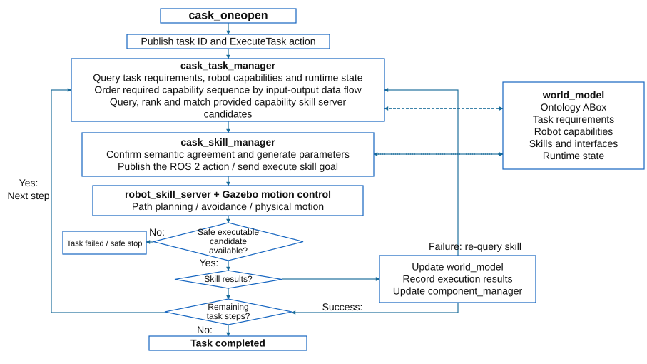

# Ontology-Driven ROS 2 capability matching Multi-Robot Framework for construction task

**Master's thesis — Xiangcheng Li, M.Sc. Construction Robotics, RWTH Aachen University**

This project connects construction task requirements to executable robot skills through a CaSk-based semantic World Model and ROS 2. SPARQL queries identify compatible provided capabilities, a Task Manager coordinates the required operations, and a Skill Manager binds selected skills to robot action servers. Gazebo provides the simulated machines, physical payload, and measured execution feedback.

The final demonstration uses a tower crane, a Jekko mini crane, and an Innok223 tractor–trailer vehicle to move a steel payload from a shared start location to a workbench.

## Research focus

The thesis investigates semantic task/resource representation, capability matching, skill-interface binding, coordinated multi-robot execution, and runtime state updates. It combines CaSk/CSS capability–skill concepts, VDI 3682 product/process relationships, and DIN EN 61360 requirements/assurances.

Task order is derived from product input/output dependencies. Robot motion is implemented by dedicated controllers. This is a custom ROS 2 executor; it does not run a native SkiROS2 executor or a PDDL planner.

## System overview

The World Model describes the task and available resources. The Task Manager selects and orders suitable skills. The Skill Manager resolves interfaces and execution parameters. Robot servers implement lifting and navigation, while the Component Manager reports the measured payload and scene state.

## Module documentation

Each module has its own README explaining its purpose, internal files, workflow, and connections to the rest of the framework.

| Module | Documentation |
| --- | --- |
| Ontology and task/resource data | [ontology](src/ontology/README.md) |
| RDF graph, queries, and updates | [cask_world_model](src/cask_world_model/README.md) |
| Matching, sequencing, and cooperation | [cask_task_manager](src/cask_task_manager/README.md) |
| Skill discovery, parameterization, and dispatch | [cask_skill_manager](src/cask_skill_manager/README.md) |
| Payload state and scene initialization | [cask_component_manager](src/cask_component_manager/README.md) |
| Robot execution servers | [cask_robot_skill_servers](src/cask_robot_skill_servers/README.md) |
| Robot descriptions and visualization assets | [cask_robot_description](src/cask_robot_description/README.md) |
| Task, state, and ontology interfaces | [cask_interfaces](src/cask_interfaces/README.md) |
| Generic robot-skill action | [ros_interfaces](src/ros_interfaces/README.md) |
| Integrated launch and model preparation | [cask_oneopen](src/cask_oneopen/README.md) |
| Gazebo support overview | [cask_gazebo](src/cask_gazebo/README.md) |
| Motion, planning, attachment, and feedback | [cask_gazebo_motion](src/cask_gazebo/cask_gazebo_motion/README.md) |
| Optional semantic handoff protocol | [cask_handoff](src/cask_gazebo/cask_handoff/README.md) |

## Final demonstration tasks

The assignments below follow the ontology included in this workspace.

| Task | Loading / first operation | Transport | Final placement |
| --- | --- | --- | --- |
| Task_01 | Tower crane picks up the payload | Tower crane moves the suspended payload | Tower crane places it on the workbench |
| Task_02 | Jekko loads the trailer | Innok223 | Jekko unloads onto the workbench |
| Task_03 | Tower crane loads the trailer | Innok223 | Jekko unloads onto the workbench |
| Task_04 | Jekko loads the trailer | Innok223 | Tower crane unloads onto the workbench |
| Task_05 | Tower crane loads the trailer | Innok223 | Tower crane unloads onto the workbench |

Task_01 contains one required capability. Task_02–Task_05 each contain loading, transport, and unloading capabilities. Carrier/receiver preparation may overlap operations when the execution dependencies allow it.

## Build and run

The target environment is **Ubuntu 22.04, Python 3.10, ROS 2 Humble, and Ignition Gazebo Fortress / Gazebo 6**. ROS–Gazebo integration uses ros_gz_sim, ros_gz_bridge, and ros_gz_interfaces. Other main dependencies include RDFLib, Xacro, robot_state_publisher, and TF2.

Use a clean source checkout under **~/cask_gazebo_final_ws**. The final launch validates that workspace directory name. Generated build/install/log artifacts from a development backup should be rebuilt locally.

With ROS 2, Fortress, colcon, and initialized rosdep already available:

~~~bash
cd ~/cask_gazebo_final_ws
source /opt/ros/humble/setup.bash

rosdep update
rosdep install --from-paths src --ignore-src -r -y
colcon build --symlink-install --base-paths src
source install/local_setup.bash
~~~

### Terminal 1: launch

~~~bash
cd ~/cask_gazebo_final_ws
source /opt/ros/humble/setup.bash
source install/local_setup.bash

export CASK_WORKSPACE="$HOME/cask_gazebo_final_ws"
ros2 launch cask_oneopen cask_gazebo_final_oneopen.launch.py
~~~

Wait for **FINAL_SCENE_READY** before submitting a task.

### Terminal 2: execute

~~~bash
source /opt/ros/humble/setup.bash
source ~/cask_gazebo_final_ws/install/local_setup.bash

ros2 action send_goal --feedback \
  /cask_task_manager/execute_task \
  cask_interfaces/action/ExecuteTask \
  '{task_id: "Task_01"}'
~~~

Use Task_02, Task_03, Task_04, or Task_05 to select another configuration. Submit one task at a time. Relaunch between independent trials to restore consistent physical and semantic initial state.

For wall-clock duration, prefix the action command with:

~~~bash
/usr/bin/time -f 'Elapsed wall time: %E'
~~~

The prefix measures the entire ROS command until it exits, including startup/discovery and waiting. Check the action result as well as elapsed time. See the [launch guide](src/cask_oneopen/README.md) for a complete timed command and diagnostics.

## Important configuration

| File | Purpose |
| --- | --- |
| [CASK+CRO-abox.ttl](src/ontology/CASK+CRO-abox.ttl) | Tasks, requirements, assignments, provided capabilities, skill interfaces, and product states. |
| [final_scene.json](src/cask_component_manager/config/final_scene.json) | Scene geometry, robot spawn poses, payload properties, bays, and work positions. |
| [Final launch](src/cask_oneopen/launch/cask_gazebo_final_oneopen.launch.py) | Runtime parameters, bridge topics, model preparation, and startup order. |

Task coordinates and scene geometry must remain consistent. The final launch starts the World Model in reset mode. Saved RDF state alone cannot reconstruct interrupted physical payload ownership.

## Scope and reproducibility

The current matching query limits resources to Crane_01, Jekko_01, and Innok223_01. Matching, fallback, and task execution depend on modeled constraints and implemented adapters. Controllers verify measured motion/payload state; they do not provide a general solution for arbitrary robot tasks or physical hardware deployment.

The module READMEs were checked against the uploaded source. No new ROS 2 build or Gazebo trial was performed as part of this documentation change. Existing root tests and package lint scaffolding are retained; they are not a complete physical acceptance suite.

The backup also includes older task individuals, historical helpers, runtime files, and a root handoff/ reference directory. Those are distinct from the active final five-task launch.

For GitHub, version source, configuration, assets, and documentation. Exclude generated build/, install/, log/, caches, platform metadata, and obsolete backups. Package license declarations include placeholders; this README does not assign a new repository-wide license.

**Author:** Xiangcheng Li  
**Institution:** RWTH Aachen University
